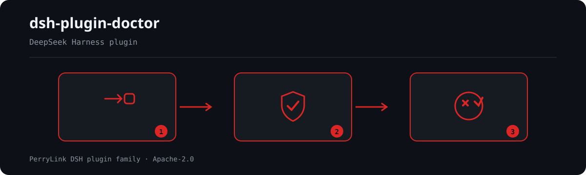

# dsh-plugin-doctor

> Release stamp: `0.4.6` (2026-10-04).

> **Package name.** This project publishes to npm as **`@perrylink/dsh-plugin-doctor`**. The bare npm name `dsh-plugin-doctor` belongs to a different, unrelated project — never run `npx dsh-plugin-doctor`; installing it does not install this plugin.

[](LICENSE)
[](https://www.npmjs.com/package/@perrylink/dsh-plugin-doctor)
[](https://www.npmjs.com/package/@perrylink/dsh-plugin-doctor)
[](#)
[](https://github.com/PerryLink/dsh-plugin-doctor/actions)
[](https://dshfind.com/plugins/PerryLink/dsh-plugin-doctor?ref=badge)
[](https://api.securityscorecards.dev/projects/github.com/PerryLink/dsh-plugin-doctor)

[English](README.md) · [简体中文](README-zh.md) · [Español](README-es.md) · [Português](README-pt.md) · [हिन्दी](README-hi.md)

```sh
dsh plugin --profile <name> add @perrylink/dsh-plugin-doctor
```


An all-in-one "integrity + runtime health" checker for dsh plugins. Zero dependencies (it uses
only what Node ≥22 ships), and one run covers four layers at once:
**static package-structure checks (R) → Cordis contract scan (K) → dynamic sandbox smoke (D) → ecosystem directory-listing validation (CC)**.
Every criterion traces back to three first-hand research tracks dated 2026-09-07: the deepseek-harness
docs and source, the cordiverse/cordis source contracts, and an inventory of every distribution
channel in the workspace (full text in `SURVEY.md`).

**📖 Ecosystem knowledge base** — measured data, not marketing: [plugin development guide · plugin-selection data · maintenance criteria](https://perrylink.github.io/dsh-plugin-guide/).

<!-- star-cta -->
## Installation (DSH bundle)

```sh
dsh plugin --profile web add github:PerryLink/dsh-plugin-doctor
```

`dsh-plugin-doctor` declares `dsh.bundle.patch` → `cordis.patch.yml` in package.json, so it can also be installed as a DeepSeek Harness bundle:

```powershell
# git channel (latest main)
dsh plugin --profile web add github:PerryLink/dsh-plugin-doctor

# npm channel (released version; always use the scoped full name -- the bare name dsh-plugin-doctor is a different project)
dsh plugin --profile web add @perrylink/dsh-plugin-doctor
```

The inserted line loads this package under the standard Cordis plugin contract: the host half is a plain ESM module exporting `apply(ctx)` (declaring `inject` for the services it needs). The package ships no browser UI, so there is no `dsh.client` declaration.

```js
// bundle entry (host half) -- the export contract the patch line loads
export function apply(ctx) {
  // registers the /doctor command and the plugin_doctor read-only check tool
}
```

Uninstall: `dsh plugin --profile web remove @perrylink/dsh-plugin-doctor` (or delete that line from the profile patch). The CLI usage below is unaffected.

## ⭐ 如果它帮到了你

这个插件是 [DSH 插件家族](https://github.com/PerryLink)的一员（95 个，全部 Apache-2.0）。如果你在用，**给个 star** —— 它不会解锁任何功能，但会让下一个人在搜索里更容易找到它。

*English:* part of a 95 plugin family for DeepSeek Harness. If it is useful, **a star helps the next person find it** — nothing is gated behind it.


## What is dsh-plugin-doctor?

An all-in-one "integrity + runtime health" checker for dsh plugins. Zero dependencies (it uses only what Node ≥22 ships), and one run covers four layers at once:



*Workflow overview: request → policy / review → verdict. The examples below use the real command surface.*


## Comparison


60 candidates → 20 qualifying plugins · scan dated 2026-09-10 (data/rk-scans.json)

## Compatibility

| Surface | Status |
|---|---|
| Harness | DeepSeek Harness `dsh-v0.2.1-alpha.1` (zero-dependency and host-agnostic by design: `package.json` declares no `@deepseek-ai/dsh-*` dependency and no peer range at all, so this repository's `R5`/`R8` skip deliberately instead of passing — see `SELF-CHECK.md`; the line is recorded in `CHANGELOG.md` §0.4.6, "host pins move to `0.2.1-alpha.1`", and the D-group sandbox smoke takes its host from `--dsh`, default the peer floor `0.1.2-rc.1`) |
| Node | `^22.19.0 \|\| >=24.0.0` |

## Usage

```powershell
node doctor.mjs --repo <插件仓路径>            # 全量（含动态冒烟，需网络 + pnpm）
node doctor.mjs --repo <路径> --no-smoke       # 仅静态 + 清单
node doctor.mjs --repo <路径> --dsh 0.1.7-alpha.1 # 冒烟宿主版本（默认 npm latest 已发布线）
node doctor.mjs --repo <路径> --only R,K       # 只跑静态两层（推荐用 ASCII 别名）
node doctor.mjs --repo <路径> --json report.json
node doctor.mjs --repo <路径> --json -         # JSON 写 stdout（此时抑制人类可读报告）
node doctor.mjs --repo <路径> --format check --json -   # 生态三值契约视图（PASS/WARN/FAIL + 0/1/2）
node doctor.mjs --repo <路径> --workspace <工作区根>   # 指定兄弟仓所在工作区（CC 组核对用）
node doctor.mjs --repo <路径> --allow-degraded # 显式接受「整组未真跑」（默认 exit 6）
node doctor.mjs --purge <隔离目录>              # 清理本工具产生的隔离目录（仅 doctor-quarantine-*）
```

### Host half: `plugin_doctor` / `/doctor` (new in 0.7.1)

Installed as a bundle, the plugin registers the same R/K/X checks as a read-only
tool and a command. Two things differ from the CLI, and both are stated in the
reply because **the host half has no exit code** — the returned report is the
whole message:

| Parameter | Default | Meaning |
|---|---|---|
| `repo` (required) | — | plugin repository path (needs `package.json`) |
| `smoke` | `false` | also run the D-group sandbox smoke (needs network + pnpm) |
| `host` | `true` | run the X group (host-contract checks); degrades when no dsh install is readable |
| `workspace` | auto | family workspace holding the sibling `dsh-*` repos, for CC1–CC5 and K14 |

- **Degraded runs say so.** When a requested group never really ran, the reply
  carries the same `[降级] …不可当作通过` line the CLI prints, naming the groups.
  Before 0.7.1 the renderer dropped that fact, so a degraded reply was
  indistinguishable from a run with nothing to do.
- **`workspace` is resolved from the repository, not from the install.** The
  tool walks up from the repository under check to the nearest directory holding
  two or more DSH plugin repos (`DSH_WORKSPACE` and the explicit parameter win
  over it). Resolving it as `import.meta.dirname/..` — as 0.7.0 did — yields
  `<profile>/node_modules` (or `…/@perrylink`) once the package is installed as a
  bundle, which is not a workspace at all: CC1–CC4 then report "not present
  locally" for registries that do exist, and K14 never finds a sibling. When no
  workspace can be located the reply says so explicitly, instead of letting
  those skips read as absent registries.

### Target shapes and coverage (new in 0.2.0)

`--repo` may be a **source tree** or an **installed package directory / unpacked tarball artifact** (the latter is common at `node_modules/<pkg>`). The criteria change with the shape:

| Shape | K group (Cordis contract) | Notes |
|---|---|---|
| Source tree with `src/` | scans `src/**` plus root-level JS (`mode: src`) | complete |
| **No `src/`, `main` points at `lib/`** | **fallback scan of `lib/**` (`mode: lib-fallback`)** | fixed in 0.2.0: the old implementation keyed on "no build script", but published packages **keep** their build script → the fallback never fired, all nine K checks were skipped, and it still exited 0 (false green) |
| Neither `src/` nor `lib/` | all nine skipped (`mode: none`) | **the whole group never really ran → exit code 6**, no more false green |

Coverage is written to `coverage.K` in the JSON (`{filesInspected, mode}`) and summarised in `groups.K`.

### `--only` groups and ASCII aliases

| Alias | Full group name | Contents |
|---|---|---|
| `R` | static · package structure | R0–R8 |
| `K` | static · Cordis contract scan | K1–K9 |
| `D` | dynamic · sandbox smoke | D0–D3, D9 |
| `CC` | ecosystem · directory listings | CC1–CC5 |

Aliases are case-insensitive, and the Chinese full names still work. **Use the aliases in workflows**: if an editor or script round-trips a Chinese group name through the wrong encoding, `--only` matches no group at all.

### Exit-code contract

| Code | Meaning | Introduced |
|---|---|---|
| `0` | no fail/error (warn/skip allowed), and every requested group really ran | 0.1.x |
| `1` | fail/error present (a plugin defect) | 0.1.x |
| `2` | usage error, unknown group, **unknown option** | 0.1.x |
| `3` | infrastructure error (missing npm/pnpm and the like) | **0.2.0** |
| `4` | unsupported host version (the host itself failed to install; **not** a plugin verdict) | **0.2.0** |
| `5` | unstable result (a step timed out or was killed by a signal) | **0.2.0** |
| `6` | **degraded**: a requested group never really ran (e.g. no source files to scan) | **0.2.0** |

**Guarding against silent passes** (two layers):

1. If even one group name in `--only` fails to match → immediately `2`. Versions 0.1.4 and earlier would "check nothing + exit 0" when a group name was mangled, which once turned the CI gates of 35 repos into false green (measured 2026-09-09: `checks_run=0`, `exit=0`).
2. From 0.2.0: **a requested group whose checks all skipped → `6`**. The old implementation only covered "not a single check ran", not "it ran but everything skipped" — the latter let "K group with zero coverage" count as a pass. To accept that explicitly, use `--allow-degraded` (exit code drops to 0, but `degraded` stays non-empty in the JSON).

> ⚠️ The existing gates in 41 family repos **do not read the exit code** (their workflows use `set +e` / `out="$(…)"` / `set -e`) and only parse the `R0 ` / `K1 ` prefixes on stdout and `results[].name` in the JSON. So 0.2.0's new exit codes **change nothing for those pipelines**; they serve interactive use and future integrators.

- The smoke run keeps its temporary `DSH_HOME`/`DSH_AGENTS_HOME` inside a self-made `%TEMP%` sandbox (prefix `doctor-`, which **does not overlap** the host-protected `%TEMP%\dsh-*` template) and never touches the real `~/.dsh` (red line 3).
- `dsh plugin add` is always passed `--ignore-scripts`: the tested package's install/prepare scripts never execute on the host. A pnpm ignored-builds block is classified as `environment` (it counts neither as a pass nor as a plugin defect).
- Every step's subprocess stdout/stderr is written to `%TEMP%\doctor-run-*\logs\`; at the end the run **quarantines instead of deleting** (renames to `%TEMP%\doctor-quarantine-*`), prints that path in the report tail, and leaves removal to `--purge` after a human confirms (red line 4, the three-stage rule).
- Absolute paths seen at runtime are placeholder-ised to `<path>` before they reach the JSON or the rendered text, so a report can be committed into someone else's repo without tripping its path-leak gate.

## Name collisions (important)

This repository is **`@perrylink/dsh-plugin-doctor`**, and it is **not the same project** as other same-named tools in the ecosystem:

- The bare npm name `dsh-plugin-doctor` belongs to **Xrainsmile/DSH-Plugin-Doctor** (a different project, 0.1.1). So **never run `npx dsh-plugin-doctor`** — that executes someone else's package; always use the scoped full name `@perrylink/dsh-plugin-doctor@<exact version>`.
- Ten GitHub repos carry `dsh-plugin-doctor` in their name (eight of them **exactly** that name), including `zoahdev/dsh-plugin-doctor` (GitHub-only, never published to npm).
- `dsh-testkit`'s README links `dsh-plugin-doctor` to the zoahdev repo; that has nothing to do with this one.

In one line: **zero-dependency, offline-capable (`--only R,K`), and it turns the Cordis v4 contracts (K1–K9) and five ecosystem directory listings (CC1–CC5) into a CI gate whose verdict is readable from the exit code.** (No "the only" style claim — merely that nothing comparable appeared within the set of tools actually surveyed.)

**Inline one-liner.** `--format check` emits the ecosystem's three-value contract
(`PASS`/`WARN`/`FAIL`, exit `0`/`1`/`2`, flat `checks[]`) instead of this
project's enriched envelope, so another checker or Action can consume the result
directly. It is a *view*: it never changes whether a project passes, and a `skip`
is never rendered as `PASS` (it becomes `WARN` with `skipped: true`). The full
semantics stay in a `doctor` side field. See `SPEC.md` §1.1 — those three
properties are normative and `tests/compat.mjs` asserts them.

## Check catalog

| Group | Checks | What the criteria cover |
|---|---|---|
| static · package structure | R0–R8 | base fields; **the activation gate `dsh.bundle.patch` (critical)**; `npm pack --dry-run` tarball contains the entry and the patch; cordis.patch.yml structure; entry `name`/`apply` exports; rescoped dependency policy (bare `cordis` forbidden); engines aligned to `^22.19.0 \|\| >=24.0.0`; prebuild + files allowlist; leftover old-rc peers (the 2026-09-05 dual-baseline lesson) |
| static · Cordis contract | K1–K9 | service access vs `inject` declaration; the ctx live-data serialization red line; timers/listeners not wrapped in `ctx.effect`; Schema containing a function; `apply` return shape (the v4 Effect contract); `inject` service-name seam; **v3 legacy APIs (the 3.x→4.x removal list)**; Config must be a Standard Schema; the `name==='apply'` special case |
| dynamic · sandbox smoke | D0–D3, D9 | `npm pack` → `dsh plugin --profile headless add <tarball>` → assert `dsh.profile.bundles` contains the package name → `--dump-config` layer marker → keyless headless run expected to **exit 1 + `dsh: MISSING_CREDENTIAL`** (= the composition booted as far as a model request; NO_ADAPTER/ERR_MODULE_NOT_FOUND/SyntaxError/TypeError are excluded) → sandbox cleanup |
| ecosystem · directory listings | CC1–CC5 | the certification registry spec v1 five-dimension evidence; adp-list yml fields/enums/descriptions; dsh-catalog entry constraints (install commands forbidden, truncation heuristics); the omdsh `dshWorkshop` activation five values; the dsh-plugin-kit three gates (license / five-language README / the three seam roles, preferring the kit's official CLI) |

## Verified 徽章

There are **two badge paths**, and they make different claims. Pick the one whose
claim you can actually back. **[`FOR-ADOPTERS.md`](FOR-ADOPTERS.md) is the
step-by-step version of this section** — the exact file to copy, the exact badge
markdown, what each verdict means, and what this check does *not* prove.

### Path A — self-serve gate badge (no permission needed, no author involvement)

This badge makes **one narrow, checkable claim**: *the repository runs
dsh-plugin-doctor's static R+K gate in its own CI, and that workflow is green on
the repository's default branch.* It is rendered by shields.io directly from your
own workflow's status, so it needs no registry entry, no pull request, no token
from anyone, and it cannot be broken by this project's infrastructure:

```markdown
[](https://github.com/PerryLink/dsh-plugin-doctor/blob/main/SPEC.md)
```

Replace `<owner>/<repo>` (and `branch=` if your default branch is not `main`).
The link target is `SPEC.md` — the criteria you are claiming to meet, and an
explicit statement of who authored them.

**Use Path A.** It is the whole standard, self-serve, and it is what this
specification is designed for. It requires nothing of this project.

Two honest caveats about Path A: the badge reflects *your* workflow, so it is
only as trustworthy as your CI configuration — it is not verified by anyone
else; and it is served by shields.io, which learns your repository name.

### Path B — author-issued audited badge

Wearing this badge means exactly one auditable thing: **the repo runs dsh-plugin-doctor's static R+K gate (16 checks: R0/R1/R3/R5/R6/R7/R8 + K1–K9) in its own CI, and that gate is green on the current HEAD of the default branch**, *as re-checked by this project's auditor*. It is **not** a certification badge: no Scorecard, no provenance, no install smoke. R2 (tarball integrity) and R4 (entry contract) read the built `lib/`, and building most family repos needs `HARNESS_COMMIT` + `gen-aliases` to pass — those two are covered by each repo's own `ci.yml` (build-drift gate + pack smoke) and are deliberately outside this gate.

```markdown
[](https://github.com/PerryLink/dsh-plugin-doctor#verified-徽章)
[](https://dsh.market/)
```

**Path B is a centralized, single-operator service and should be treated as
such.** It needs a fine-grained PAT with cross-repository read access, stored as
the `DOCTOR_AUDIT_TOKEN` repository secret. The workflow-scoped `GITHUB_TOKEN`
**cannot** substitute for it: it carries no cross-repository read permission, so
GitHub treats it as an anonymous caller limited to 60 requests/hour, while a full
audit of the declared repos needs 200+. Without the PAT, every badge renders grey
`NO DATA` — the failure looks like a broken badge program rather than a missing
secret. This has happened (once as `401`, then as `403 rate limit exceeded`), and
it is the reason Path A exists and is recommended. `scripts/verify.mjs` now stops
at the first such response, exits `3`, and writes a registry whose reasons name
the real cause instead of emitting the same rate-limit line for every repo.
- The registry `data/verified.json` is the single source of truth for Path B, refreshed by `.github/workflows/verified.yml` daily and on every relevant push. A refresh only reads the GitHub API: it parses each repo's HEAD `plugin-doctor.yml` gate configuration (which must pin `@perrylink/dsh-plugin-doctor@<version>`, use a working `--only` argument, and self-verify that R0/K1 actually ran), then checks the conclusion of that HEAD's `plugin-doctor` workflow run. **This repo's CI never clones, installs or executes any third-party code.**
- Badge appearance: the visual language follows the two newer badges in the ecosystem (`dsh.directory`'s monospace-uppercase + letter-spacing + mark + gradient, and `awesome-dsh-plugin`'s seal block) — **a silver/platinum metallic left segment, a shield tick mark, and ink-blue monospace uppercase**, with the right segment a **solid GitHub-convention status colour** (green/orange/red/grey) carrying a monospace uppercase status word, and the status additionally expressed by a **path-drawn icon** (✓ / ! / ✕ / –) so it stays readable with colour-vision deficiency. 5px corner radius + 1px stroke; **the stroke is required** — without it the silver left segment disappears against a white README background.
- Four states (value text uses the shields / GitHub Actions conventional words): `passing` (green: the HEAD run succeeded) / `warning` (orange: HEAD has not run yet, a run is still queued, or a gate precondition is missing) / `failing` (red: the HEAD run failed, or the gate configuration does not hold — including a "fake gate" whose `--only` argument is doubly mis-encoded) / `no data` (grey: the API query failed). The badge is **dynamic**: once it stops passing it turns red. The precise R+K scope lives in this section and in the registry's `meaning` field, not in the badge text (the badge links back here).
- To join Path B: open a PR against `data/verified-repos.json` adding `{ "repo": "<owner>/<name>", "package": "<npm package name>" }`, and add `plugin-doctor.yml` to your own repo; the entry must pass the audit above. **Path A needs none of this.**
- **The gate file is shipped, not scraped.** Copy [`plugin-doctor.yml`](plugin-doctor.yml) — the canonical, ready-to-use workflow — to `.github/workflows/plugin-doctor.yml` in your repository and adjust the pin. It is also inside the npm tarball, so `npx @perrylink/dsh-plugin-doctor` users can read the shipped copy instead of reconstructing the step from this README. Group names use the **ASCII aliases `R,K`** (supported since 0.1.5, keeping file and command line pure ASCII), and the tail self-verifies that R0/K1 really ran.

> Why the gate installs and builds nothing, and why this repo does not run the badge itself: the static R/K checks read only the committed tree (no dependencies needed), whereas `npm run build` fails in an environment without the harness aliases, and its prebuild wipes the committed `lib/`, manufacturing a false red. Concentrating third-party dependency installs into this repo's CI, on the other hand, would be a supply-chain risk. So the gate runs inside each repo's own CI against the committed tree, and this repo only audits and issues the Path B badge.

## Where the criteria come from (full text and URLs in SURVEY.md)

- **harness side**: `docs/user/develop/basic/publish.md`, `apps/cli/src/plugin.ts` (the activation gate is the only switch),
  `packages/bundle/headless/README.md` (the MISSING_CREDENTIAL criterion), Releases (the 0.1.2-rc.1 / 0.1.3-alpha.1 changes),
  `@deepseek-ai/dsh-loader-smoke` (the official "temporary DSH_HOME + expected exit code" pattern).
- **Cordis side**: the cordiverse/cordis v4 source (registry/fiber/reflect/events.ts) + the DSH cordis-primer/tutorial docs +
  the v3 `@cordisjs/core@3.10.2` d.ts diff (the 3.x→4.x blacklist).
- **Ecosystem side**: the dsh-plugin-certification spec v1, adp-list `entries.mjs`/`check-submission.mjs`,
  dsh-catalog `validate.mjs`/`deploy.yml` live smoke, omdsh build-submission, dsh-plugin-kit `verify/*`.

## Release health

A green release workflow does not prove a correct release. On 2026-10-05 the family shipped
37 packages and the failures that mattered were invisible in the job colour: 36 CHANGELOGs
carried the literal date `undefined`, two packages published successfully and still ended red,
one failed `ENEEDAUTH` because npm's trusted-publisher binding named a workflow file that no
longer performs the OIDC exchange, and one never reached npm at all because its pre-publish
`verify` gate failed first and the publish job was `skipped`.

`scripts/check-release-health.mjs` checks the four things that cover all of those:

| Pass | Question | Needs network |
|---|---|---|
| LOCKSTEP | does every version carrier in the repo agree with `package.json`? | no |
| PUBLISHED | is the local version the one on the registry? | yes |
| PROVENANCE | which workflow file published it, and is that a current publish file? | yes |
| FILES | does the published tarball still carry `src/`, `lib/` or `dist/`? | yes |

```sh
# one repository, offline (the mode a downstream repo should use in its own CI)
node scripts/check-release-health.mjs --repo . --no-registry

# the whole declared family, from the registry, without checking any of it out
node scripts/check-release-health.mjs --roster data/verified-repos.json
```

Exit codes: `0` healthy, `1` at least one problem, `2` usage error. `--json <path>` writes the
machine-readable report, `--quiet` prints only failures. The weekly
`.github/workflows/release-health.yml` runs both modes and uploads the report.

Only two carrier shapes fail the check, because only two are asserted family-wide:
`src/version.ts`'s exported `VERSION`, and a `VERSION` file where one exists. A `SKILL.md`
version difference is reported as a note — most skills version independently.
## Known limits (stated honestly)

- The K group is a **heuristic static scan**: K1/K3/K4 miss complex wrappers and can also raise false alarms — every warn-level finding needs a human look and never condemns a plugin automatically.
- D3 only proves that "the composition boots as far as a model request"; it **does not prove the tool schemas are valid or the business logic correct** (that needs a keyed e2e run or a mock LLM).
- A pnpm `ignored-builds` block is an environment-recipe problem: when D1 hits it, the check degrades to warn and prints the compat.yml allowBuilds recipe, matching the certification spec v1's environment-blocked line, and it never counts as a plugin defect.
- npm-line hosts (0.1.2-rc.1) have no engines/peerDependencies enforcement in their packument, so R6 is advisory there.
- A measured trap in this environment: a `$` anchor (without the `m` flag) does not match the position before a lone trailing `\r`, so parsing CRLF text must split on `/\r?\n/` (already handled internally — do not regress it).

## Repository layout

```
doctor.mjs               CLI entry (group orchestration, exit codes, JSON report)
lib/framework.mjs        check registration/run/verdict/rendering (zero dependencies)
lib/util.mjs             temporary sandbox + subprocess execution (stdout/stderr to disk, avoiding pipe-capture limits)
lib/checks-package.mjs   static · package structure R0–R8
lib/checks-cordis.mjs    static · Cordis contract K1–K9
lib/checks-smoke.mjs     dynamic · sandbox smoke D0–D3, D9
lib/checks-collections.mjs  ecosystem · directory listings CC1–CC5
tests/selftest.mjs       14 real-CLI self-tests (the 7 existing exit-code-contract cases byte-identical, plus 7 new degraded/usage-guard cases)
tests/contract.mjs       31 contract tests (freezing the 5 observables the existing 37-repo CI depends on)
tests/spec-drift.mjs     guard tying SPEC.md to the implementation (check IDs, gate set, the single critical check, authorship)
tests/spec-id-token.mjs  shared parser for SPEC §1 ID lists, including `K1–K9` range expansion
tests/spec-drift-meta.mjs  tests the drift guard itself, so it cannot pass vacuously
tests/compat.mjs         25 tests for `--format check`: the two views must agree on pass/fail,
                         and a `skip` must never be rendered as a `PASS`
scripts/verify.mjs       verified registry and badge refresh (reads the GitHub API to audit each repo's gate)
scripts/badge.mjs        verified SVG rendering
scripts/check-cross-repo.mjs     monthly K14 cross-repo gate (stages the family from published tarballs)
scripts/check-release-health.mjs weekly release health (version carriers, registry, provenance, tarball)
data/verified-repos.json verified declaring repos
data/verified.json       verified registry (CI-generated)
badges/                  verified badges (CI-generated)
THIRD-PARTY-RK-SCAN.md   third-party plugin static R+K scan result set (public report)
data/rk-scans.json       machine-readable form of that scan
SURVEY.md                the full-channel detection methodology plus every criterion's source
SPEC.md                  the normative verification criteria (authored by PerryLink)
GOVERNANCE.md            authorship, spec versioning, and what attribution is asked vs required
NOTICE                   Apache-2.0 attribution notice (must travel with redistributions)
CITATION.cff             citation metadata (for citing the tool or the criteria)
plugin-doctor.yml        the canonical CI gate, shipped ready to copy into your repo
FOR-ADOPTERS.md          the adopter's landing page: gate, badge, verdicts, limits
SELF-CHECK.md            this tool's own result against its own criteria
OUTREACH.md              adoption notes: channel states, positioning, actions
```

## Status

Official repository: GitHub `PerryLink/dsh-plugin-doctor` (Apache-2.0), npm `@perrylink/dsh-plugin-doctor`.
**Current version 0.4.6**, published to npm. Releases go out through **npm Trusted
Publishing (OIDC)** — no long-lived token — after the `NPM_TOKEN` secret expired
and blocked the 0.2.4 and 0.3.0 attempts. See `CHANGELOG.md`. CI usage
(**please use the ASCII aliases**):

```powershell
npx --yes @perrylink/dsh-plugin-doctor@0.5.0 --repo . --no-smoke --only "R,K"
```

Or as a **GitHub Action** — no install step, no copied workflow file:

```yaml
- uses: PerryLink/dsh-plugin-doctor@v0.4.6
  with:
    only: R,K
```

**43 PerryLink repositories** ship the gate, and the whole fleet was moved onto one
byte-identical template pinned to the current version on 2026-09-23/24, after the
change was verified against every gated repository first. New adopters should pin
the **newest published** version — currently 0.4.6.

> **Honest status: there are no external adopters yet.** That, not catalogue
> coverage, is what limits this project — it is already in 33+ directories
> including every high-star one. Measurements and the reasoning are in
> [`OUTREACH.md`](OUTREACH.md) §C4.

> Every 0.2.0 change is **additive** (new fields / new options / new exit codes); the criteria for the existing 37 repos are unchanged, verified against the 37-repo baseline with **diffs = 0**.

### Authorship of the criteria

The verification criteria — not only the tool that implements them — were
authored by **PerryLink** (<https://github.com/PerryLink>). Their normative text
is [`SPEC.md`](SPEC.md), and this repository is the canonical source for both the
specification and the reference implementation. See [`GOVERNANCE.md`](GOVERNANCE.md)
for how the criteria change and for what attribution is requested (versus
required by Apache-2.0 §4(d) via [`NOTICE`](NOTICE)).

Adopting the gate needs no permission. If you adopt it, please keep the criteria
attributed to PerryLink and do not present them as your own standard.


### Public result sets

- [`THIRD-PARTY-RK-SCAN.md`](https://github.com/PerryLink/dsh-plugin-doctor/blob/main/THIRD-PARTY-RK-SCAN.md) — the first static R+K scan of **third-party** (non-PerryLink) dsh plugins: 60 candidates → 20 plugins that really declare `dsh.bundle.patch` → under the 16-check gate, **10 passed / 10 failed**. Method: read-only clones, **zero execution** of third-party code, R2/R4 listed separately and not gated; it includes the reproduction commands, a correction to this scan's own methodology, and a **correction channel for any repo named in it**. Machine-readable form: `data/rk-scans.json`.
  **It is not a certification, not a rating, and says nothing about a plugin's security**: a pass means only that "the 16 static checks reported no failure on that commit".

## PerryLink DSH Plugin Family

This project is part of the DeepSeek Harness plugin family from [PerryLink](https://github.com/PerryLink). The roster stays collapsed below so every README keeps a short first screen; expand it to see every row and its status.

<details>
<summary>Expand all plugins</summary>

| Plugin | Status |
|---|---|
| **[dsh-aqua-input-check](https://github.com/PerryLink/dsh-aqua-input-check)** |  |
| **[dsh-archive-check](https://github.com/PerryLink/dsh-archive-check)** |  |
| **[dsh-auto-review](https://github.com/PerryLink/dsh-auto-review)** |  |
| **[dsh-autotier](https://github.com/PerryLink/dsh-autotier)** |  |
| **[dsh-bid-ca-precheck](https://github.com/PerryLink/dsh-bid-ca-precheck)** |  |
| **[dsh-bid-qual-check](https://github.com/PerryLink/dsh-bid-qual-check)** |  |
| **[dsh-cert-mcp](https://github.com/PerryLink/dsh-cert-mcp)** |  |
| **[dsh-checkpoint-rewind](https://github.com/PerryLink/dsh-checkpoint-rewind)** |  |
| **[dsh-click](https://github.com/PerryLink/dsh-click)** |  |
| **[dsh-composer-history](https://github.com/PerryLink/dsh-composer-history)** |  |
| **[dsh-contract-stance](https://github.com/PerryLink/dsh-contract-stance)** |  |
| **[dsh-customs-doc-check](https://github.com/PerryLink/dsh-customs-doc-check)** |  |
| **[dsh-data-quality](https://github.com/PerryLink/dsh-data-quality)** |  |
| **[dsh-demurrage-ledger](https://github.com/PerryLink/dsh-demurrage-ledger)** |  |
| **[dsh-doublecheck](https://github.com/PerryLink/dsh-doublecheck)** |  |
| **[dsh-drill-script-check](https://github.com/PerryLink/dsh-drill-script-check)** |  |
| **[dsh-eia-guide-check](https://github.com/PerryLink/dsh-eia-guide-check)** |  |
| **[dsh-emergency-plan](https://github.com/PerryLink/dsh-emergency-plan)** |  |
| **[dsh-essay-rubric-check](https://github.com/PerryLink/dsh-essay-rubric-check)** |  |
| **[dsh-evidence-check](https://github.com/PerryLink/dsh-evidence-check)** |  |
| **[dsh-export-ctl-check](https://github.com/PerryLink/dsh-export-ctl-check)** |  |
| **[dsh-fast](https://github.com/PerryLink/dsh-fast)** |  |
| **[dsh-fmea-table-check](https://github.com/PerryLink/dsh-fmea-table-check)** |  |
| **[dsh-forecast-penalty](https://github.com/PerryLink/dsh-forecast-penalty)** |  |
| **[dsh-fund-research](https://github.com/PerryLink/dsh-fund-research)** |  |
| **[dsh-github](https://github.com/PerryLink/dsh-github)** |  |
| **[dsh-gongwen-flow-check](https://github.com/PerryLink/dsh-gongwen-flow-check)** |  |
| **[dsh-gongwen-word-check](https://github.com/PerryLink/dsh-gongwen-word-check)** |  |
| **[dsh-guard-plan-qc](https://github.com/PerryLink/dsh-guard-plan-qc)** |  |
| **[dsh-hazchem-check](https://github.com/PerryLink/dsh-hazchem-check)** |  |
| **[dsh-hazplan-check](https://github.com/PerryLink/dsh-hazplan-check)** |  |
| **[dsh-hidden-risk-map](https://github.com/PerryLink/dsh-hidden-risk-map)** |  |
| **[dsh-hs-classify](https://github.com/PerryLink/dsh-hs-classify)** |  |
| **[dsh-icd-rule-check](https://github.com/PerryLink/dsh-icd-rule-check)** |  |
| **[dsh-industry-research](https://github.com/PerryLink/dsh-industry-research)** |  |
| **[dsh-lawcite-adapter](https://github.com/PerryLink/dsh-lawcite-adapter)** |  |
| **[dsh-laya](https://github.com/PerryLink/dsh-laya)** |  |
| **[dsh-lc-doc-check](https://github.com/PerryLink/dsh-lc-doc-check)** |  |
| **[dsh-learning-gap-check](https://github.com/PerryLink/dsh-learning-gap-check)** |  |
| **[dsh-library](https://github.com/PerryLink/dsh-library)** |  |
| **[dsh-local-ai](https://github.com/PerryLink/dsh-local-ai)** |  |
| **[dsh-lsp-actions](https://github.com/PerryLink/dsh-lsp-actions)** |  |
| **[dsh-mask](https://github.com/PerryLink/dsh-mask)** |  |
| **[dsh-mcp-panel](https://github.com/PerryLink/dsh-mcp-panel)** |  |
| **[dsh-medrec-qc](https://github.com/PerryLink/dsh-medrec-qc)** |  |
| **[dsh-memento](https://github.com/PerryLink/dsh-memento)** |  |
| **[dsh-nsfc-form-check](https://github.com/PerryLink/dsh-nsfc-form-check)** |  |
| **[dsh-nurse-record-check](https://github.com/PerryLink/dsh-nurse-record-check)** |  |
| **[dsh-observe](https://github.com/PerryLink/dsh-observe)** |  |
| **[dsh-origin-rvc-check](https://github.com/PerryLink/dsh-origin-rvc-check)** |  |
| **[dsh-ota-review-check](https://github.com/PerryLink/dsh-ota-review-check)** |  |
| **[dsh-output-styles](https://github.com/PerryLink/dsh-output-styles)** |  |
| **[dsh-paper-doc-adapter](https://github.com/PerryLink/dsh-paper-doc-adapter)** |  |
| **[dsh-permission-rules](https://github.com/PerryLink/dsh-permission-rules)** |  |
| **[dsh-permit-report-check](https://github.com/PerryLink/dsh-permit-report-check)** |  |
| **[dsh-pipeline-check](https://github.com/PerryLink/dsh-pipeline-check)** |  |
| **[dsh-pleading-draft](https://github.com/PerryLink/dsh-pleading-draft)** |  |
| **[dsh-plugin-doctor](https://github.com/PerryLink/dsh-plugin-doctor)** |  |
| **[dsh-plugin-guide](https://github.com/PerryLink/dsh-plugin-guide)** |  |
| **[dsh-plugin-kit](https://github.com/PerryLink/dsh-plugin-kit)** |  |
| **[dsh-plugin-upgrade](https://github.com/PerryLink/dsh-plugin-upgrade)** |  |
| **[dsh-policy-brief-draft](https://github.com/PerryLink/dsh-policy-brief-draft)** |  |
| **[dsh-power-loss-split](https://github.com/PerryLink/dsh-power-loss-split)** |  |
| **[dsh-power-ticket-check](https://github.com/PerryLink/dsh-power-ticket-check)** |  |
| **[dsh-ppap-check](https://github.com/PerryLink/dsh-ppap-check)** |  |
| **[dsh-protest-deadline](https://github.com/PerryLink/dsh-protest-deadline)** |  |
| **[dsh-railway-window](https://github.com/PerryLink/dsh-railway-window)** |  |
| **[dsh-repair-order-qc](https://github.com/PerryLink/dsh-repair-order-qc)** |  |
| **[dsh-research-report](https://github.com/PerryLink/dsh-research-report)** |  |
| **[dsh-review-reply-check](https://github.com/PerryLink/dsh-review-reply-check)** |  |
| **[dsh-rulefile-check](https://github.com/PerryLink/dsh-rulefile-check)** |  |
| **[dsh-safety-brief-check](https://github.com/PerryLink/dsh-safety-brief-check)** |  |
| **[dsh-score](https://github.com/PerryLink/dsh-score)** |  |
| **[dsh-session-sync](https://github.com/PerryLink/dsh-session-sync)** |  |
| **[dsh-site-log-check](https://github.com/PerryLink/dsh-site-log-check)** |  |
| **[dsh-skill-pack-security](https://github.com/PerryLink/dsh-skill-pack-security)** |  |
| **[dsh-soe-decision-check](https://github.com/PerryLink/dsh-soe-decision-check)** |  |
| **[dsh-soilwater-check](https://github.com/PerryLink/dsh-soilwater-check)** |  |
| **[dsh-sop-sync-check](https://github.com/PerryLink/dsh-sop-sync-check)** |  |
| **[dsh-spc-gbt-adapter](https://github.com/PerryLink/dsh-spc-gbt-adapter)** |  |
| **[dsh-talk](https://github.com/PerryLink/dsh-talk)** |  |
| **[dsh-tender-extract](https://github.com/PerryLink/dsh-tender-extract)** |  |
| **[dsh-tender-matrix](https://github.com/PerryLink/dsh-tender-matrix)** |  |
| **[dsh-test-drive](https://github.com/PerryLink/dsh-test-drive)** |  |
| **[dsh-ticktick](https://github.com/PerryLink/dsh-ticktick)** |  |
| **[dsh-translate](https://github.com/PerryLink/dsh-translate)** |  |
| **[dsh-warranty-calc](https://github.com/PerryLink/dsh-warranty-calc)** |  |
| **[dsh-budget](https://github.com/PerryLink/dsh-budget)** | 🧊 FROZEN — see the repo README |
| **[dsh-claude-move](https://github.com/PerryLink/dsh-claude-move)** | 🧊 FROZEN — see the repo README |
| **[dsh-defend](https://github.com/PerryLink/dsh-defend)** | 🧊 FROZEN — see the repo README |
| **[dsh-draw](https://github.com/PerryLink/dsh-draw)** | 🧊 FROZEN — see the repo README |
| **[dsh-reach](https://github.com/PerryLink/dsh-reach)** | 🧊 FROZEN — see the repo README |
| **[dsh-background-agents](https://github.com/PerryLink/dsh-background-agents)** | 🚫 RETIRED — see the repo README |
| **[dsh-session-pin](https://github.com/PerryLink/dsh-session-pin)** | 🚫 RETIRED — see the repo README |
| **[dsh-team-rooms](https://github.com/PerryLink/dsh-team-rooms)** | 🚫 RETIRED — see the repo README |

</details>

### Examples

These are the plugin's real entry points; install once, then call one.

#### Detailed example

**Command**

~~~sh
node doctor.mjs --repo . --no-smoke --only R,K
~~~

**Output**

~~~text
== 静态·包结构 ==
[PASS] R0 基础字段（name/version/license/README/type）
    基础字段齐全
[PASS] R1 激活门 dsh.bundle.patch [关键]
    dsh.bundle.patch = ./cordis.patch.yml
~~~

*Observed from `README.md:89-95 (Usage); lib/framework.mjs:121 (render)`*

#### Failure branch

**Input**

~~~text
node doctor.mjs --repo . --only NOPE --no-smoke
~~~

**Output**

~~~text
未知分组: NOPE
可用分组: 静态·包结构（R）, 静态·cordis 契约扫描（K）, 动态面·宿主契约（X）, 生态·集合站清单（CC）
~~~

*Observed from `plugins/dsh-plugin-doctor/doctor.mjs:196-206; plugins/dsh-plugin-doctor/tests/selftest.mjs:95; plugins/dsh-plugin-doctor/README.md:169-171`*

#### Brief examples


